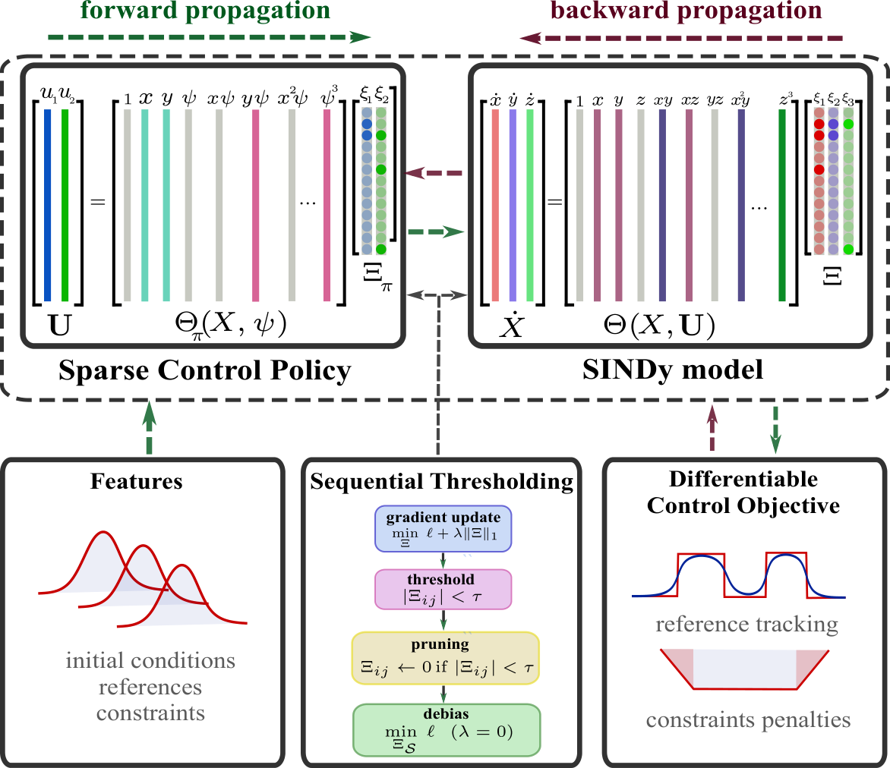
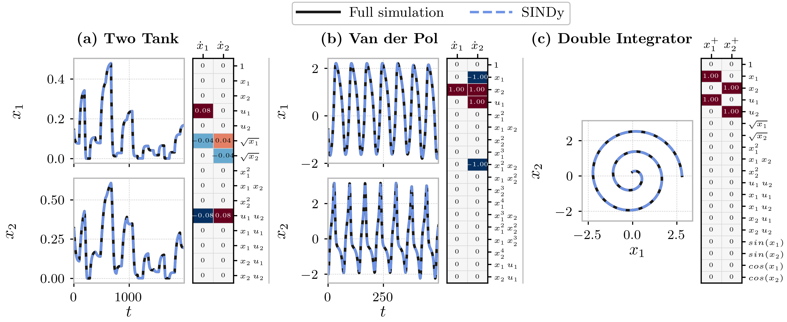
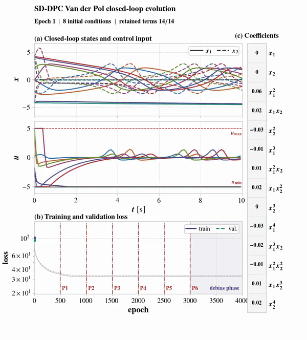
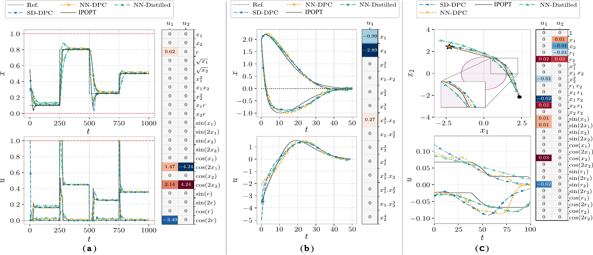

<div align="center">

# SD-DPC: Sparse Dictionary Differentiable Predictive Control

[](https://www.python.org/)
[](https://pytorch.org/)
[](https://github.com/pnnl/neuromancer)

</div>

SD-DPC learns both a sparse prediction model and a sparse feedback controller. The resulting policy is a compact symbolic expression whose active terms and coefficients can be inspected directly, while training still accounts for long-horizon closed-loop behavior, control effort, and constraints.

<p align="center">
  <a href="assets/DPC_simple_method_vert.pdf"></a>
</p>

## Method

Given state-input trajectories, SD-DPC first identifies a sparse dynamics map

$$
\hat{x}_{t+1}=F_{\Xi_f}(x_t,u_t)
=\Theta_f(x_t,u_t)\,\Xi_f,
$$

where $\Theta_f$ is a prescribed dictionary of candidate functions and $\Xi_f$ is a sparse coefficient matrix. The identification loss combines one-step and rollout errors with an $\ell_1$ penalty:

$$
\min_{\Xi_f}\;
\frac{1}{m_{\mathrm{id}}}\sum_{j=1}^{m_{\mathrm{id}}}
\left(
Q_1\lVert \hat{x}^{(j)}_1-x^{(j)}_1\rVert_2^2
+Q_N\sum_{k=1}^{N_{\mathrm{id}}}
\lVert \hat{x}^{(j)}_k-x^{(j)}_k\rVert_2^2
\right)
+\lambda\lVert\Xi_f\rVert_1.
$$

The controller uses a second dictionary and projects its raw output onto the admissible input set:

$$
u_t=\pi_{\Xi_\pi}(x_t,\psi_t)
=\Pi_{\mathcal U}\!\left(
\Theta_\pi(x_t,\psi_t)\,\Xi_\pi
\right).
$$

Policy coefficients are optimized through the differentiable closed-loop rollout

$$
\begin{aligned}
\min_{\Xi_\pi}\quad &
\frac{1}{m}\sum_{j=1}^{m}
\left[
\sum_{k=0}^{N-1}\ell_{\mathrm{DPC}}
\bigl(x_k^{(j)},u_k^{(j)},\psi_k^{(j)}\bigr)
+\ell_N\bigl(x_N^{(j)},\psi_N^{(j)}\bigr)
\right]
+\lambda_\pi\lVert\Xi_\pi\rVert_1,\\
\text{s.t.}\quad &
x_{k+1}^{(j)}=F_{\Xi_f}\bigl(x_k^{(j)},u_k^{(j)}\bigr),
\qquad
u_k^{(j)}=\pi_{\Xi_\pi}\bigl(x_k^{(j)},\psi_k^{(j)}\bigr).
\end{aligned}
$$

Sequential thresholding removes coefficients with magnitude below $\tau$ or $\tau_\pi$. After the support stabilizes, a debias phase creates a fresh AdamW optimizer, fixes the retained support, sets the sparsity weight to zero, and refits only the surviving coefficients. Debiasing is independently configurable for system identification and policy learning with `debias.enabled: true|false`.

## Case studies

| System | Control task | Retained SD-DPC policy |
| --- | --- | ---: |
| [Two Tank](case_studies/TwoTank) | Constrained liquid-level tracking | 4 + 2 terms |
| [Van der Pol](case_studies/VanDerPol) | Stabilization of the one-input, relative-degree-two oscillator | 3 terms |
| [2-D Integrator](case_studies/DoubleIntegrator) | Setpoint reaching with obstacle avoidance | 8 + 4 terms |

Each case is self-contained under `case_studies/<Case>/`: runtime configurations are in `configs/`, tutorial notebooks are in `notebooks/`, and the pretrained checkpoints are in `checkpoints/`. The executable entry points are grouped under the matching `scripts/<Case>/` directory.

### Policy training configurations

The policy training configurations use the following settings. The case names link to the complete YAML files, which also specify the data domains, optimizer schedule, action projection, NN-DPC settings, and distillation settings.

| Parameter | [Two Tank](case_studies/TwoTank/configs/policy.yaml) | [Van der Pol](case_studies/VanDerPol/configs/policy.yaml) | [2-D Integrator](case_studies/DoubleIntegrator/configs/policy.yaml) |
| --- | ---: | ---: | ---: |
| Random seed / policy seed | 0 / 0 | 0 / 6 | 0 / 5 |
| Training scenarios | 2,000 | 1,000 | 2,000 |
| Rollout horizon | 50 | 50 | 100 |
| Batch size | 200 | 200 | 200 |
| Maximum training epochs | 12,000 | 12,000 | 12,000 |
| Learning rate | $5\times10^{-3}$ | $1.5\times10^{-3}$ | $5\times10^{-4}$ |
| Gradient clipping | 5 | 10 | 1 |
| Action gradient band | 0.05 | 0.05 | 0.01 |
| Action gradient leak | 0.01 | 0.01 | 0.05 |
| $\ell_1$ weight $\lambda_\pi$ | 0.1 | 0.001 | 0.016 |
| Pruning threshold $\tau_\pi$ | 0.2 | 0.0625 | 0.004 |
| Pruning interval | 800 epochs | 800 epochs | 800 epochs |
| Stable pruning stages | 3 | 3 | 3 |
| Debias epochs | 800 | 800 | 800 |
| Retained terms per control output | 4 + 2 | 3 | 8 + 4 |

The closed-loop objective weights are:

| Weight | Two Tank | Van der Pol | 2-D Integrator |
| --- | ---: | ---: | ---: |
| Tracking, $Q_r$ | 20 | 20 | 1 |
| Control magnitude, $Q_u$ | 0 | 5 | 10 |
| Terminal control, $Q_{u_f}$ | — | — | 5 |
| State increments, $Q_{\Delta x}$ | 0 | 0 | 1 |
| Control increments, $Q_{\Delta u}$ | 0 | 1 | 10 |
| State/input constraints | $Q_{\mathrm{con}}=20$ | $Q_{\mathrm{con}}=20$ | $Q_{\mathrm{con},x}=Q_{\mathrm{con},u}=1$ |
| Obstacle constraint, $Q_{\mathrm{obs}}$ | — | — | 100 |


## Results

The identified models achieve accurate held-out rollouts for all three systems:

<p align="center">
  <a href="results/system_identification/three_case_dynamics_rollout.pdf"></a>
</p>

### Van der Pol policy evolution

The animation below follows sparse policy learning for the Van der Pol case. It shows
the closed-loop state and control trajectories, and the
coefficient matrix as sequential thresholding removes dictionary terms. Pruned terms
remain visible with coefficients fixed at zero.

<p align="center">
  <a href="results/policy_evolution/vanderpol_closed_loop_policy_evolution.mp4"></a>
</p>

<p align="center"><sub>Click the animation to open the full-resolution MP4.</sub></p>

Closed-loop evaluation compares SD-DPC with NN-DPC, a sparse policy distilled from NN-DPC, and an IPOPT benchmark. Learned controllers are evaluated over 500 held-out scenarios on the true plants.

<p align="center">
  <a href="results/evaluation/evaluation_systems_result.pdf"></a>
</p>

| System | Method | Task loss $[10^{-3}]$ | Control effort | Time / memory | Violations [% / depth] |
| --- | --- | ---: | ---: | ---: | ---: |
| Two Tank | IPOPT | $8.8\times10^{-6}$ | — | 8444 µs / 26 MiB | 0.0 / — |
|  | NN-DPC | $0.144\pm0.013$ | — | 30 µs / 5.01 kB | 0.0 / — |
|  | **SD-DPC** | **$0.012\pm0.006$** | — | **17 µs / 0.047 kB** | 0.0 / — |
|  | NN-Distilled | $0.209\pm0.039$ | — | 17 µs / 0.047 kB | 0.0 / — |
| Van der Pol | IPOPT | $4.6\times10^{-24}$ | — | 301 µs / 19 MiB | 0.0 / — |
|  | NN-DPC | **$41.0\pm124.4$** | — | 29 µs / 5.01 kB | 0.0 / — |
|  | **SD-DPC** | $49.9\pm126.4$ | — | **17 µs / 0.023 kB** | 0.0 / — |
|  | NN-Distilled | $96.8\pm183.8$ | — | 17 µs / 0.023 kB | 0.0 / — |
| 2-D Integrator | IPOPT | $0.000\pm0.000$ | $12.00\pm1.18$ | 1841 µs / 18 MiB | 0.0 / — |
|  | NN-DPC | **$0.298\pm0.560$** | **$12.00\pm1.16$** | 28 µs / 5.01 kB | 0.0 / — |
|  | **SD-DPC** | $4.75\pm4.79$ | $12.07\pm1.12$ | **17 µs / 0.094 kB** | 0.2 / 0.01 |
|  | NN-Distilled | $62.6\pm58.0$ | $12.07\pm1.03$ | 17 µs / 0.094 kB | 60.8 / 1.61 |

Task loss is reported as mean $\pm$ standard deviation. Computation time is measured per control step using the compiled implementations rather than eager execution. Memory is learned-policy parameter storage; IPOPT reports additional resident memory per solve. The source table and full metric definitions are in [`controller_performance_extended.tex`](results/evaluation/controller_performance_extended.tex).

## Installation

The project is tested with Python 3.10, PyTorch 2.6.0, and Neuromancer 1.5.3. From a fresh checkout:

```bash
git clone https://github.com/SOLARIS-JHU/SD-DPC.git
cd SD-DPC
python3.10 -m venv .venv
source .venv/bin/activate
python -m pip install --upgrade pip
python -m pip install -e .
```

CasADi supplies the nonlinear MPC benchmark, and JupyterLab supports the notebook workflow. On Windows, activate the environment with `.venv\Scripts\activate`.

Verify the installation:

```bash
python -c "import sdpc, torch, neuromancer; print('SD-DPC installation OK')"
```

### Reproducibility

The default evaluation commands load the included checkpoints and use the fixed seeds,
scenario counts, and horizons in the case configuration files. They reproduce the task
loss, control effort, policy size, and retained terms in the results table to the shown
precision. Inference time depends on the processor and compiler available on the machine.

Training is deterministic on the documented CPU environment and is expected to recover
the same sparse supports and results at the shown precision. Floating-point coefficients
can differ slightly across operating systems, PyTorch versions, and CPU or GPU backends;
the serialized checkpoint files are therefore the canonical exact policies.

## Reproduce the reported controller results

The following commands use the included checkpoints and fixed 500-scenario evaluation
sets. The first evaluates SD-DPC and NN-DPC. The second reconstructs NN-Distilled from
the included policies and verifies its displayed task, effort, safety, and memory values.

```bash
CASE=TwoTank
python scripts/$CASE/evaluation.py
python scripts/$CASE/train_nn_distilled.py
```

## Tutorial: retrain a case

All commands below run from the repository root. Choose one of `TwoTank`, `VanDerPol`, or `DoubleIntegrator` and keep the same case name through every stage.

```bash
CASE=TwoTank

# 1. Identify sparse dynamics and run the fixed-support debias refit.
python scripts/$CASE/system_id.py

# 2. Train the sparse SD-DPC policy on the latest identified model.
python scripts/$CASE/train_sd_dpc.py

# 3. Train the NN-DPC comparison policy on the same model and objective.
python scripts/$CASE/train_nn_dpc.py
```

Training outputs are written without overwriting previous runs:

```text
case_studies/<Case>/results/
├── models/dynamics/run_N/saved_models/
│   ├── sindy_pruned.pt
│   ├── sindy_debiased.pt
│   └── sindy.pt
├── models/policies/sd_dpc/run_N/saved_models/
│   ├── policy_sparse_pruned.pt
│   ├── policy_sparse_debiased.pt
│   └── policy_sparse.pt
├── models/policies/nn_dpc/run_N/saved_models/policy_nn.pth
├── models/policies/nn_distilled/run_N/saved_models/policy_nn_distilled.pt
└── eval/
```

The distillation command uses the included NN-DPC teacher and the retained terms of the included SD-DPC policy. It fits only the sparse coefficients by ordinary least squares, evaluates 500 held-out true-plant scenarios, and stops with an error if the displayed task loss, control effort, violation rate, or indexed memory differs from the table. The evaluation YAML points to the included pretrained checkpoints, so the reproduction commands can run immediately after installation and remain independent of a new training run. To evaluate newly trained models, copy the case's evaluation YAML and remove `sindy_path`, `policy_path`, and `nn_policy_path`; checkpoint discovery will then select the latest completed runs.

Debiasing is enabled by default for both sparse stages. To disable it for an experiment, copy the relevant YAML and set:

```yaml
debias:
  enabled: false
```

Pass a custom configuration without changing the included defaults:

```bash
python scripts/TwoTank/train_sd_dpc.py --config /path/to/policy_experiment.yaml
```

The system identification, SD-DPC, NN-DPC, and evaluation scripts accept `--device` and `--seed`. The distillation script accepts `--device` and an optional `--output-dir`. Use `--help` on any entry point for its options. The notebooks `01_system_id.ipynb` through `04_plot_evaluation_results.ipynb` provide the same case workflow interactively. They load the same case YAML files without shortening the epoch or scenario budgets, execute the configured debias phase, and save resolved config snapshots with their outputs.

For Colab, open `00_colab_workflow.ipynb` in the selected case directory. The streamlined notebook explains the method and case dynamics, then runs system identification, policy learning, and evaluation in one runtime without mounting Google Drive. By default, it loads the pretrained dynamics and policy checkpoints. Each stage starts with its relevant inputs: training switches, nominal rollout conditions, and the evaluation initial state, time-step horizon, scenario count, and controller methods. The 2-D integrator rollout also exposes the obstacle ellipse geometry. Set `TRAIN_SYSTEM_ID` or `TRAIN_POLICY` to `True` to retrain that stage from the case YAML; newly trained models are saved in numbered runs and passed directly to downstream stages. Colab storage is temporary, so download any artifacts that should be retained before ending the runtime.

## Repository layout

```text
assets/          Method diagram in PDF and README-ready PNG
case_studies/    Three case studies, each with configs, notebooks, and checkpoints
scripts/         Matching command-line entry points for every case and stage
src/sdpc/        Systems, sparse models, training, MPC, metrics, and plotting
results/         Included figures, policy-training animation, and evaluation table
```

## Citation

```bibtex
@article{garmroodi2026sd,
  title={SD-DPC: Sparse Dictionary Differentiable Predictive Control},
  author={Garmroodi, Ali Reza Daneshvar and Drgo{\v{n}}a, Jan},
  journal={arXiv preprint arXiv:2610.02466},
  year={2026}
}
```

## Acknowledgements

SD-DPC builds on [Neuromancer](https://github.com/pnnl/neuromancer), [PyTorch](https://pytorch.org/), and [CasADi](https://web.casadi.org/).
